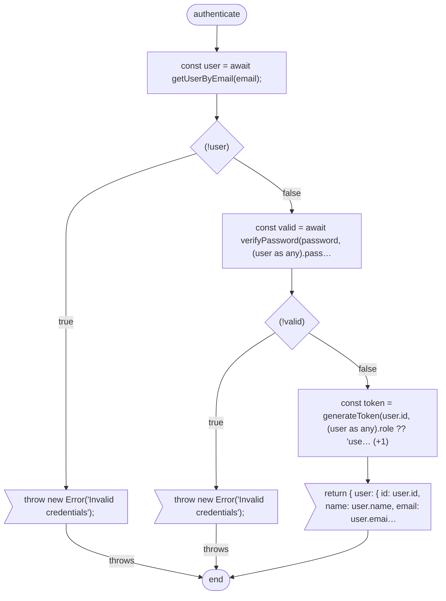

# CLI reference

Every `clarifydoc` command and option. For what the files it writes contain and how to read them, see
[Reading the output](reading-the-output.md).

```text
clarifydoc analyze <path>             Analyze a codebase → per-file JSON, project-summary.json, report-data.json
clarifydoc impact <path>              What a set of changed files reaches: screens, routes, entities, tests
clarifydoc report <analysis-dir>      (Re)build report.html from an existing analysis
clarifydoc lsp-update <analysis-dir>  Add the LSP layer (Docker) to an existing analysis
clarifydoc cfg <file>                 Draw one function's control flow as Mermaid
clarifydoc seq <path> --route <route> Draw what a route does, in order, as a Mermaid sequence diagram
clarifydoc detect <path>              Print detected file types and frameworks; writes nothing
clarifydoc schema                     Print the top-level fields of a per-file analysis
clarifydoc export <path>              Render the analysis as ARCHITECTURE.md, DATA-MODEL.md, FLOWS.md, Mermaid, GraphML, Cypher
clarifydoc mcp [path]                 Serve the analysis to an AI agent over MCP (stdio)
clarifydoc ask <tool> [key=value…]    Call one MCP tool from a shell or CI and print its answer
clarifydoc install [path]             Wire ClarifyDoc into agent hosts: MCP entry, hooks, skills, AGENTS.md section
clarifydoc hook <event>               The agent-host hook `install --hooks` registers (reads the payload on stdin)
```

`clarifydoc --version` prints the version; `clarifydoc help <command>` (or `<command> --help`) prints a
command's options. Every example below works the same with `npx clarifydoc`, `npx .` inside a clone, or
`node dist/cli.js` — see [Install](../README.md#install).

## Where the analysis lives

`analyze` writes to **`<output>/<name>/`**, where `<output>` is the `-o` value (default `.clarifydoc`)
resolved against the **current working directory**, and `<name>` is the last folder name of the analyzed
path.

| You run | From | Output directory |
|---------|------|------------------|
| `clarifydoc analyze .` | `~/src/shop` | `~/src/shop/.clarifydoc/shop/` |
| `clarifydoc analyze ./shop` | `~/src` | `~/src/.clarifydoc/shop/` |
| `clarifydoc analyze . -o /tmp/maps` | `~/src/shop` | `/tmp/maps/shop/` |

`impact` and `mcp` find the analysis the same way — from the project path and `-o` — so give them the same
`-o` and run them from the same directory as `analyze`. `report` and `lsp-update` take the analysis directory
itself.

When the output directory is inside the project, the first run drops a `.gitignore` containing `*` into it,
so the analysis never shows up in `git status`. Empty that file to commit the analysis instead; it is only
written when absent. `.clarifydoc/` is always excluded from discovery, so a scan never reads its own output.

## `analyze`

```bash
clarifydoc analyze <path> [options]
```

Discovers every supported source file under `<path>`, extracts it, links the results across files and
sub-projects, and writes the analysis.

| Option | Default | What it does |
|--------|---------|--------------|
| `-o, --output <dir>` | `.clarifydoc` | Parent of the output directory (see above). |
| `--include <globs...>` | every supported extension | Analyze **only** files matching these globs. Replaces the default file set; the default ignores still apply. |
| `--exclude <globs...>` | — | Skip files matching these globs, on top of the default ignores and `.clarifydocignore`. |
| `--max-files <n>` | unlimited | Analyze at most the first `n` discovered files. For a quick look at a huge repo, not for real results — links to the files left out are lost. |
| `--incremental` | off | Reuse the per-file results of files whose content is unchanged since the last run (SHA-256, with an mtime fast path). Writes `manifest.json`, and from the second run on `impact-latest.json`. |
| `--no-lsp` | LSP on | Skip the LSP layer. It needs Docker; without Docker it is skipped anyway, with a note under `--verbose`. |
| `--lsp-timeout <ms>` | 60000 per server | How long to wait for a language server to start. |
| `--no-git-history` | history on | Skip reading `git log` (24 months). Without it there is no churn, no hotspots, and refactor pressure scores without its churn component. |
| `--html` | off | After the analysis, build `report.html` and open it in the browser. |
| `--import-sarif <files...>` | — | Join other tools' SARIF 2.1 findings (Semgrep, CodeQL, gosec, Bandit, Checkov…) to the map. Each result on an analyzed file becomes a finding tagged with its tool and rule, mapped to a category by its CWE, and gets the API routes that reach it. Results on files the analysis did not read are counted in `importedFindings`, not kept. They stay out of `--sarif` (the tool reported them) and out of the health grade. |
| `--pretty` / `--no-pretty` | `--pretty` | Indented or compact JSON. Compact is roughly 40% smaller. |
| `--stable-output` | off | Write a fixed timestamp and a relative project root, so two runs over the same source produce byte-identical files. For analyses you commit and diff. |
| `--dry-run` | off | List the files that would be analyzed and stop. Writes nothing. |
| `--verbose` | off | Print each pipeline step and per-file progress. |

The ignore list that always applies (`node_modules`, `dist`, `build`, `vendor`, `target`, `*.min.js`, …),
`.clarifydocignore` syntax and `.clarifydoc/config.json` are described in the [README](../README.md#default-ignores).

A run ends with a summary of what it found:

```text
Done. Analysis complete.
  Files:         16
  Elements:       0 interactive
  Screens:        0
  Routes:        10
  Links:          6
  Traces:        30
  Health:         A
  Patterns:       0
  Security:       0 issue(s)
  Suggestions:    3
  Output: /home/me/src/shop/.clarifydoc/shop
```

[Reading the output → the console summary](reading-the-output.md#the-console-summary) says which part of
the analysis each line counts.

```bash
# The first look at a project
clarifydoc analyze . --html

# Day-to-day: only re-extract what changed
clarifydoc analyze . --incremental

# CI: no Docker, no browser, reproducible files
clarifydoc analyze . --no-lsp --stable-output

# Only the TypeScript, with the generated client left out
clarifydoc analyze ./web --include "**/*.ts" "**/*.tsx" --exclude "src/api/generated/**"
```

Only one process writes an analysis directory at a time. A second `analyze` on the same directory fails
straight away with `Another ClarifyDoc analysis is writing …`; the lock is `.analysis-lock.json` inside
the directory and frees itself when its owner dies. Delete it by hand only if the message names a run that
is no longer running.

## `impact`

```bash
clarifydoc impact <path> [options]
```

Projects a set of changed files onto an **existing** analysis and prints what they reach: the screens and API
routes whose code runs through them, the entities and queues they touch, the files that depend on them, and
the tests among those. It reads the analysis and never re-analyzes — run `analyze` first (`--incremental`
keeps that cheap), or the answer describes the code as it was at the last run.

| Option | Default | What it does |
|--------|---------|--------------|
| `-o, --output <dir>` | `.clarifydoc` | Same value you gave `analyze`. |
| `--base <ref>` | `HEAD` | Diff the working tree against this git ref. Untracked files count as changed. |
| `--staged` | off | Use only staged changes (`git diff --cached`). |
| `--files <files...>` | — | Give the changed files yourself, project-relative. Skips git entirely. |
| `--json` | off | Print the full result as JSON. |
| `--md` | off | Print a Markdown summary, ready to paste into a pull-request comment. |

```bash
clarifydoc impact . --base origin/main --md
clarifydoc impact . --files src/services/orders.ts
```

```text
Impact of 1 changed file(s)  [base: --files]
Risk: MODERATE — inventory/Controllers/ItemsController.cs is a boundary file (high impact); …; affects 4 API route(s)

Changed:  inventory/Controllers/ItemsController.cs

API routes reached (4):
  GET /api/items  (inventory/Controllers/ItemsController.cs:9)
  GET /api/items/{id}  (inventory/Controllers/ItemsController.cs:12)
  GET /api/orders  (orders/Controllers/OrdersController.cs:19)
  POST /api/orders  (orders/Controllers/OrdersController.cs:26)

Dependent files: 0
```

[Reading the output → impact](reading-the-output.md#impact-latestjson-and-impact---json) explains every field
of the JSON form.

## `report`

```bash
clarifydoc report <analysis-dir> [--no-open]
```

Builds `report.html` in the analysis directory from its `project-summary.json` (merging a current
`lsp-enhancement.json` when there is one) and opens it. `--no-open` only writes it. The report is a single
offline file you can attach or host anywhere; rebuild it after upgrading ClarifyDoc, since an old
`report.html` keeps the viewer it was built with.

## `lsp-update`

```bash
clarifydoc lsp-update <analysis-dir> [options]
```

Runs the optional second layer on an analysis that already exists: real language servers in Docker answer
`textDocument/definition` and `references` for the calls the text linker could not resolve. Writes
`lsp-enhancement.json` beside the summary, plus `lsp-ground-truth.json`, the raw log of every query. `report`
and `mcp` merge the enhancement automatically — unless it is older than the summary, in which case it is
reported as stale and left out, except for the links it added between files that have not changed since
(after an `--incremental` run, which keeps the file hashes); run `lsp-update` again for the rest.

| Option | Default | What it does |
|--------|---------|--------------|
| `--project-root <path>` | the root recorded in the summary | Where the source is, when it is not at that root — it moved, or `--stable-output` recorded it relative. |
| `--lsp-timeout <ms>` | 60000 per server | Language-server startup timeout. |
| `--pretty` / `--no-pretty` | `--pretty` | JSON formatting. |
| `--verbose` | off | Progress and debug output. |
| `--emit-queries <file>` | — | Write the definition questions (file, line, column at the called name, language) to `<file>` and stop. No server starts. |
| `--answers <file>` | — | Take the definitions from `<file>` instead of Docker: `{ "source": "editor", "answers": [{ "file", "line", "column", "targets": [{ "file", "line" }] }] }`. An answer with more than one distinct target is left out, as are targets outside the project. References are not asked, and `lsp-ground-truth.json` is not written. |
| `--scip <file>` | — | Take the definitions from a SCIP index (`index.scip`, as scip-typescript, scip-java, scip-python or rust-analyzer write it) instead of Docker. Each unresolved call is looked up at its position in the index; the symbol's defining occurrence is the target. An index built in a parent or child directory of the project is mapped by its path prefix. Same rules as `--answers`. |

`--emit-queries` and `--answers` let an editor that already runs the project's language servers stand in for
Docker: it answers the emitted questions with its own definition provider and hands them back. `--scip` does
the same from an index a CI job already builds, with no server at all.

Servers exist for TypeScript/JavaScript, Python, Java, Kotlin, C# and VB.NET, Go, Rust, Ruby, PHP and
Pascal/Delphi. Images build on first use and are cached; the first run of a language is slow.

## `seq`

```bash
clarifydoc seq <path> --route "POST /api/orders" [--file <file>] [--depth <n>]
clarifydoc seq <path> --symbol OrderService.create [--file <file>]
```

What an endpoint (or a function) does, in order, as a Mermaid `sequenceDiagram`: its handler, then every
call it makes depth-first in source order, each followed by its return; the tables it reads and writes and
the queues it publishes to; and the HTTP calls it makes to another tier, into the handler that serves them.
Lanes are classes, else files. A call the linker only guessed is drawn with an open arrow and a `?`; a
recursion is marked, not followed. Reads a written analysis (`-o` / `--analysis-dir`, as `export`), writes
nothing, prints to stdout.

| Option | Default | What it does |
|--------|---------|--------------|
| `--route <route>` | — | `METHOD /path`, or a path alone when it is unique. |
| `--symbol <symbol>` | — | A function or method instead of a route. |
| `--file <file>` | — | The declaring file, when the route or name is not unique. |
| `--depth <n>` | 8 | Hops of calls to follow. |

## `cfg`

```bash
clarifydoc cfg <file> [--function <name> | --line <n>] [--format mermaid|markdown|json]
```

Draws the control-flow graph of one function — the structure behind its complexity number. Reads one file,
writes nothing, needs no prior analysis.

| Option | Default | What it does |
|--------|---------|--------------|
| `-f, --function <name>` | — | The function to draw: `Class.method` or the bare name. |
| `-l, --line <n>` | — | The function whose body covers this 1-based line. |
| `--format <format>` | `mermaid` | `mermaid` draws exactly one function; `markdown` and `json` can hold every function in the file. |
| `--no-styled` | styled | Leave out the colour definitions, keeping only the class names, for a host that themes the diagram itself. |
| `--capabilities` | — | Print the languages and extensions that can be drawn, as JSON, and exit. |

```bash
clarifydoc cfg src/services/authService.ts --function authenticate > authenticate.mmd
```



Node shapes carry the kind: rounded ends for entry and exit, a diamond for a decision, a hexagon for a loop,
a flag for `return`/`throw`, a slanted box for `break`/`continue`, a double-edged box for `catch`, a circle
where branches merge, and a plain box for any other statement. A `(+1)` on a statement counts branches inside
it that get no node of their own — here the `??` — which is why this function's cyclomatic complexity is 4
while the graph shows two decisions.

In the default `mermaid` format, a file with several functions and no `--function` or `--line` gets a list of
them, with line ranges and complexity, and exit code 1. Caveats go to stderr as `note: …`, so `> file.mmd`
stays valid Mermaid.

Graphs are exact for TypeScript/JavaScript (including Vue and Svelte), C#, Python, PHP, Java, Kotlin and
Pascal/Delphi. Go, Rust, C, C++, Objective-C, Swift, Dart and Perl are drawn from the text and marked
`approximate`.

## `detect`

```bash
clarifydoc detect <path>
```

Prints the file extensions present and the frameworks detected across the root and every sub-project, with
the evidence for each. Fast, and writes nothing — a check of what `analyze` will recognise before you run it.

```text
Project info:
  Root: /home/me/src/shop
  File extensions: .cs, .csproj, .json, .ts, .xml, .yml
  Detected frameworks:
    - ASP.NET (.csproj Web SDK / AspNetCore reference)
    - JAX-RS (build file dependency)
```

## `schema`

Prints the top-level field names of a per-file analysis. The complete, commented definitions of every file
ClarifyDoc writes are the TypeScript types in [src/types/analysis.ts](../src/types/analysis.ts):
`FileAnalysis` for the per-file JSON and `ProjectAnalysis` for the summary.

## `mcp`

```bash
clarifydoc mcp [path] [options]
```

Serves the analysis over the Model Context Protocol on stdio, so an AI agent can query the map instead of
reading files. With no path it serves the project containing the working directory, and runs a first
analysis itself if there is none. Setup and the tool list are in the [README](../README.md#mcp-server--for-ai-agents).

| Option | Default | What it does |
|--------|---------|--------------|
| `-o, --output <dir>` | `.clarifydoc` | Same value you gave `analyze`. |
| `--analysis-dir <dir>` | — | The exact directory holding `project-summary.json`; overrides `-o`. |
| `--no-auto-analyze` | re-analysis allowed | Refuse the agent's requests to re-analyze. The first analysis still runs when none exists. |
| `--no-cold-start` | cold start allowed | Never analyze, not even the first time. |
| `--lsp` | off | Allow the LSP layer in the analyses this server runs. |
| `--no-git-history`, `--max-files`, `--include`, `--exclude` | as `analyze` | Apply to the analyses this server runs (always incremental). |

## `ask`

```bash
clarifydoc ask <tool> [key=value ...] [options]
clarifydoc ask --list
```

Calls one MCP tool and prints its answer: the same tools, validation and caps an agent gets, with no client.
The tool is named with or without its `clarifydoc_` prefix (`routes`, `blast-radius`). A `key=value` value that
reads as JSON (`3`, `true`, `["route"]`) is taken as JSON, else as a string. Read-only by default: with no
analysis, or a stale one, it answers what the tool would say to an agent that may not re-analyze.

```bash
clarifydoc ask routes path=/api/users method=POST
clarifydoc ask trace --args '{"symbol":"createOrder","direction":"callees","depth":4}'
clarifydoc ask impact files='["src/orders.ts"]' > impact.md
```

| Option | Default | What it does |
|--------|---------|--------------|
| `-p, --project <path>` | the project containing the working directory | The project root. |
| `-o, --output <dir>` | `.clarifydoc` | Same value you gave `analyze`. |
| `--analysis-dir <dir>` | — | The exact directory holding `project-summary.json`; overrides `-o`. |
| `--args <json>` | — | Arguments as one JSON object, merged before the `key=value` pairs. |
| `--analyze` | off | Let the call run an analysis when there is none or it is stale. Its progress goes to stderr. |
| `--list` | — | Each tool with its arguments (`?` marks optional ones). |

Exits `1` when the tool answers with an error (an unknown tool, a bad argument), so a script can test it.

## `install`

```bash
clarifydoc install [path] [options]
```

Wires ClarifyDoc into the tools around a project. Every write merges into what is there and a re-run changes
nothing. With no option it writes the Claude Code MCP entry (`.mcp.json`).

| Option | What it writes |
|--------|----------------|
| `--client <names...>` | The MCP server entry for `claude-code`, `cursor`, `vscode`, `windsurf`, `gemini` or `codex`, started the way this CLI was. |
| `--hooks` | Claude Code hooks in `.claude/settings.json`: what the map knows before a search, who depends on a file after an edit, what it covers at session start (`clarifydoc hook <event>`, never blocking). |
| `--skills` | `.claude/skills/clarifydoc-*`, one per MCP workflow prompt. |
| `--guidance [file]` | A marked ClarifyDoc section of `AGENTS.md` (or the file named), with this project's hub files and gaps when an analysis exists. |
| `--git-hooks` | `post-commit`, `post-merge` and `post-checkout` (branch switches only) in this repository's hooks directory (`core.hooksPath` when set). Each starts an incremental analysis in the background, so git never waits on it. The block sits between `# clarifydoc:start` / `# clarifydoc:end` after the shebang; an existing hook keeps its lines. Set `CLARIFYDOC_NO_GIT_HOOK=1` to skip it for one command. Alone, it writes no MCP entry. |
| `-o, --output <dir>` | Where the analysis lives (default `.clarifydoc`): the facts for `--guidance`, the output of `--git-hooks`. |
| `--print` | Show what would be written instead. |

## Environment variables

| Variable | Effect |
|----------|--------|
| `CLARIFYDOC_WORKERS=<n>` | Worker threads for per-file extraction. They start at 200 files or more, at most 8 by default; `0` keeps everything in one thread. |
| `CLARIFYDOC_GIT=<path>` | The git binary used to read history. |
| `CLARIFYDOC_LSP_DEBUG=1` | Log raw language-server answers and failed queries. |

## Exit codes

`0` on success. `1` when a command fails — the message goes to stderr — including `impact` with no analysis
to read and `cfg` when no single function matched. A run that finds problems in your code (security issues,
a low health grade) still exits `0`: gate on the JSON (see
[Reading the output → recipes](reading-the-output.md#recipes)), not the exit code.
